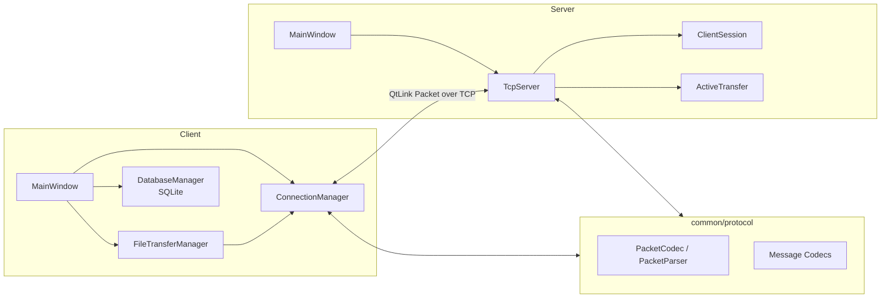

# QtLink

## Overview

QtLink is a Client-Server desktop communication project built with **C++17 and Qt**. It uses Qt Widgets for the client and server interfaces, `QTcpSocket` / `QTcpServer` for networking, and a custom TCP application protocol with message framing, file transfer control, heartbeat, and failure convergence.

The project focuses on practical C++/Qt engineering topics, including TCP stream parsing, QObject lifetime management, asynchronous file transfer, backpressure, connection recovery, and automated testing. A `clientId` is a temporary identifier assigned by the server to one TCP session; it is not a permanent user account.

## Features

- Multi-client TCP connection and session management
- Temporary `clientId` assignment and online client list synchronization
- Directed text messages using `receiverId`
- Custom QtLink binary application protocol
- Persistent receive buffers for TCP packet coalescing and fragmentation
- Local message history stored with SQLite
- Chunked file transfer, send progress, and safe received-file creation
- `FileAbort` failure handling and `FileComplete` receiver acknowledgement
- Bounded backpressure on both the Client and Server forwarding paths
- Heartbeat, connection timeout, and file transfer watchdog
- Automatic reconnect with exponential backoff
- Qt Test coverage for protocol, state-machine, and local integration behavior

## Technology

- C++17
- Qt Widgets
- `QTcpServer` / `QTcpSocket`
- Qt SQL / SQLite
- Qt Test
- CMake
- Git

## Architecture



On the Client, `MainWindow` coordinates the UI and local message history, `ConnectionManager` manages TCP, protocol traffic, heartbeat, and reconnection, and `FileTransferManager` owns file I/O and transfer state. On the Server, `TcpServer` stores per-connection receive and activity state in `ClientSession`, and validates and relays file transfers through `ActiveTransfer`. Both applications link the `qtlink_protocol` static library.

## Core Design

### 1. QtLink application protocol

Every Packet has a fixed 11-byte Header containing Magic, Version, MessageType, and BodyLength. Multi-byte integers use BigEndian encoding, and a Body is limited to 8 MiB. Text and control messages use Compact JSON. File chunks use a compact binary layout containing a UUID, offset, and raw bytes.

### 2. TCP stream parsing

Each connection owns a persistent receive buffer. `PacketParser` emits a Packet only after both the Header and complete Body have arrived. A successful parse removes only that Packet, allowing the same loop to handle one packet, fragmented packets, multiple coalesced packets, and a complete packet followed by a partial one.

### 3. ClientSession

The Server indexes `ClientSession` objects by temporary `clientId`. A Session stores its `QTcpSocket`, receive buffer, backpressure state, and activity timestamp, avoiding synchronization problems between parallel containers. Disconnect handling removes both the Session and related file transfer state.

### 4. Directed text messages

The Client sends a `TextSendRequest` containing only `receiverId` and content. The Server derives the trusted `senderId` from the current connection, validates that the receiver is online, and sends a `TextMessage` only to that client.

### 5. File transfer lifecycle

The normal flow is `FileStartRequest → FileStart → FileChunkRequest/FileChunk → FileEndRequest/FileEnd → FileCompleteRequest/FileComplete`. The Server validates and relays data without storing the file. The Receiver sends the final acknowledgement only after writing, flushing, and closing the file. Unrecoverable errors converge through `FileAbortRequest/FileAbort`, and late packets for a finished transfer are ignored safely.

### 6. High/low-water backpressure

The Client reads files in 64 KiB chunks and limits its send window using the socket's pending byte count. The Server uses a 256 KiB high-water mark and 128 KiB low-water mark for hysteresis: it pauses the related Sender when the Receiver backlog reaches the high-water mark and resumes only after the backlog drains to the low-water mark.

### 7. Heartbeat and watchdogs

The Client periodically sends an empty-body `HeartbeatRequest`, and the Server returns `HeartbeatResponse`. Both sides track valid Packet activity to detect stale connections. A separate transfer stall watchdog ensures an `ActiveTransfer` with no progress is eventually terminated. A Server Session intentionally paused by backpressure is excluded from client timeout checks.

### 8. Automatic reconnect

`ConnectionManager` distinguishes user connection intent from network failure. After an unexpected disconnect, a single-shot timer retries after 1, 2, 4, 8, and 16 seconds, capped at approximately 30 seconds. A successful connection resets the delay. A manual disconnect stops the timer, and a new TCP session never resumes an old file transfer.

## Repository Layout

```text
QtLink/
├── client/                 # Qt Widgets client, SQLite, and file transfer logic
├── server/                 # Qt Widgets server and multi-client session management
├── common/protocol/        # Packet framing, parser, and message codecs
├── tests/                  # Qt Test protocol, state-machine, and integration tests
├── docs/                   # Architecture and protocol documentation
├── screenshots/            # Application screenshots
└── CMakeLists.txt          # Top-level build entry point
```

## Requirements

- A compiler with C++17 support
- CMake 3.16 or later
- Qt 5 or Qt 6
- Qt modules: Core, Widgets, Network, Sql, and Test
- An available Qt SQLite driver

The CMake configuration does not require a specific Qt minor version; the selected Qt installation must provide the APIs and modules used by the project.

## Build and Run

From the repository root:

```bash
cmake -S . -B build
cmake --build build --config Release
```

To build only the applications:

```bash
cmake --build build --target server client --config Release
```

The executable location depends on the selected CMake generator. Start `server` first and choose a listening port in its UI. Then start one or more `client` instances and connect them to the same host and port.

The Client stores its message database as `qtlink.db` under `QStandardPaths::AppDataLocation`. Received files are created atomically under the `QtLink` subdirectory of the system Downloads location.

## Automated Tests

The current CMake configuration registers these Qt Test targets:

- `protocol_tests`: Packet encoding, stream parsing, JSON codecs, file control messages, and FileChunk
- `stage12_tests`: file transfer state, terminal-event races, failure cleanup, timeout, and backpressure regressions
- `stage14_tests`: connection states, initial failure, exponential backoff, reconnect intent, and file state cleanup
- `stage15_integration_tests`: local two-client text messaging, file control flow, server restart, watchdogs, SQLite, and object destruction

Build and run all tests:

```bash
cmake --build build --target protocol_tests stage12_tests stage14_tests stage15_integration_tests --config Release
ctest --test-dir build --output-on-failure -C Release
```

## Screenshots


## Project Status

QtLink's core communication, file transfer, failure convergence, heartbeat, and automatic reconnect features are complete. The project is currently in its stable-version cleanup and review phase.
