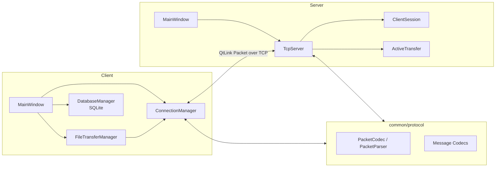

# QtLink

## 项目简介

QtLink 是一个基于 **C++17 / Qt** 的 Client-Server 桌面通信项目。项目使用 Qt Widgets 构建客户端与服务端界面，通过 `QTcpSocket` / `QTcpServer` 完成网络通信，并实现了一套包含消息边界、文件传输控制、心跳和异常收敛机制的自定义 TCP 应用层协议。

项目面向 C++/Qt 工程实践展示，重点覆盖 TCP 流式解析、Qt 对象生命周期、异步文件传输、背压、连接恢复和自动化测试。`clientId` 是服务端为当前 TCP 会话分配的临时标识，不是永久用户账号。

## 核心功能

- 多客户端 TCP 连接与会话管理
- 临时 `clientId` 分配和在线客户端列表同步
- 基于 `receiverId` 的定向文本消息
- 自定义 QtLink 二进制应用层协议
- persistent receive buffer 处理 TCP 粘包、半包和连续多包
- SQLite 本地消息历史持久化
- 文件分块传输、发送进度和安全的接收文件创建
- `FileAbort` 异常终止与 `FileComplete` 接收完成确认
- Client 与 Server 两段有界 Backpressure
- Heartbeat、连接超时和文件传输 watchdog
- Exponential Backoff 自动重连
- Qt Test 协议、状态机与本地集成测试

## 技术栈

- C++17
- Qt Widgets
- `QTcpServer` / `QTcpSocket`
- Qt SQL / SQLite
- Qt Test
- CMake
- Git

## 系统架构



客户端由 `MainWindow` 组织界面与本地消息历史，`ConnectionManager` 管理 TCP、协议收发、Heartbeat 和自动重连，`FileTransferManager` 管理文件 I/O 与传输状态。服务端的 `TcpServer` 使用 `ClientSession` 保存每条连接的独立接收缓冲和活动状态，并用 `ActiveTransfer` 验证和中继文件传输。客户端和服务端共同链接 `qtlink_protocol` 静态库。

## 核心设计

### 1. QtLink 自定义应用层协议

每个 Packet 使用固定 11 字节 Header，包含 Magic、Version、MessageType 和 BodyLength。整数采用 BigEndian 编码，Body 上限为 8 MiB。文本和控制消息使用 Compact JSON，文件 Chunk 使用 UUID、offset 和原始二进制数据组成的紧凑布局。

### 2. TCP 粘包与半包处理

每条连接维护独立的 persistent receive buffer。`PacketParser` 只在 Header 和完整 Body 都到达后产出 Packet；成功后仅移除当前 Packet，因此能连续处理单包、半包、多个粘包以及“完整包 + 下一包半包”。

### 3. ClientSession

服务端以临时 `clientId` 索引 `ClientSession`。Session 保存 `QTcpSocket`、接收缓冲、背压暂停状态和活动时间，避免多组平行容器之间的同步问题。连接断开时，相关 Session 和文件传输状态统一清理。

### 4. 定向文本消息

客户端发送 `TextSendRequest`，只提供 `receiverId` 和内容。服务端从当前连接得到可信的 `senderId`，验证目标在线后向指定客户端发送 `TextMessage`，不会把客户端提供的数据当作发送者身份。

### 5. 文件传输生命周期

正常流程为 `FileStartRequest → FileStart → FileChunkRequest/FileChunk → FileEndRequest/FileEnd → FileCompleteRequest/FileComplete`。服务端只验证并中继，不保存文件；接收端完成写入、flush 和 close 后发送最终确认。不可恢复错误通过 `FileAbortRequest/FileAbort` 收敛，迟到的旧 Packet 会被安全忽略。

### 6. 高低水位 Backpressure

客户端按 64 KiB 读取文件，并根据 socket 待写字节数限制发送窗口。服务端对下游接收端使用 256 KiB 高水位和 128 KiB 低水位形成 hysteresis：下游积压时暂停读取对应发送端，排空后再恢复，避免无界堆积文件 Chunk。

### 7. Heartbeat 与 watchdog

客户端定时发送空 Body 的 `HeartbeatRequest`，服务端返回 `HeartbeatResponse`。双方记录合法 Packet 活动时间并检测失活连接；文件传输另有 stall watchdog，保证长期无进展的 ActiveTransfer 最终终止。服务端主动暂停读取的连接不会被误判为心跳超时。

### 8. 自动重连

`ConnectionManager` 区分用户连接意图与网络故障。异常断开后使用 single-shot timer 按 1、2、4、8、16 秒增长并封顶约 30 秒；成功连接后重置退避。用户主动断开会停止定时器，新的 TCP 会话不会恢复旧文件传输。

## 项目目录

```text
QtLink/
├── client/                 # Qt Widgets 客户端与 SQLite、文件传输业务
├── server/                 # Qt Widgets 服务端与多客户端会话管理
├── common/protocol/        # Packet、Parser 和各类消息 Codec
├── tests/                  # Qt Test 协议、状态机和集成测试
├── docs/                   # 架构与协议说明
├── screenshots/            # 项目运行截图
└── CMakeLists.txt          # 顶层构建入口
```

## 环境要求

- 支持 C++17 的编译器
- CMake 3.16 或更高版本
- Qt 5 或 Qt 6
- Qt modules：Core、Widgets、Network、Sql、Test
- 可用的 Qt SQLite driver

CMake 文件没有限定具体 Qt 小版本；实际环境只需满足所用 Qt API 和上述 modules。

## 编译与运行

在仓库根目录执行：

```bash
cmake -S . -B build
cmake --build build --config Release
```

也可以只构建应用目标：

```bash
cmake --build build --target server client --config Release
```

生成文件的位置取决于所用 CMake generator。先启动 `server`，在服务端界面选择监听端口并启动监听；再启动一个或多个 `client`，填写相同的主机地址和端口进行连接。

客户端消息数据库保存在 `QStandardPaths::AppDataLocation` 对应目录下，文件名为 `qtlink.db`。接收到的文件原子创建在系统 Downloads 目录下的 `QtLink` 子目录中。

## 自动化测试

当前 CMake 注册了以下 Qt Test 目标：

- `protocol_tests`：Packet 编解码、粘包/半包、JSON Codec、文件控制消息与 FileChunk
- `stage12_tests`：文件传输状态、终态竞争、异常清理、超时与背压回归
- `stage14_tests`：连接状态、首次失败、指数退避、重连意图与文件状态清理
- `stage15_integration_tests`：本地双客户端文本通信、文件控制链路、服务端重启、watchdog、SQLite 和对象销毁

构建并运行全部测试：

```bash
cmake --build build --target protocol_tests stage12_tests stage14_tests stage15_integration_tests --config Release
ctest --test-dir build --output-on-failure -C Release
```

## 运行截图


## 项目状态

QtLink 的核心通信、文件传输、异常收敛、心跳和自动重连功能已经完成，QtLink 当前核心功能已完成，进入稳定维护状态。
