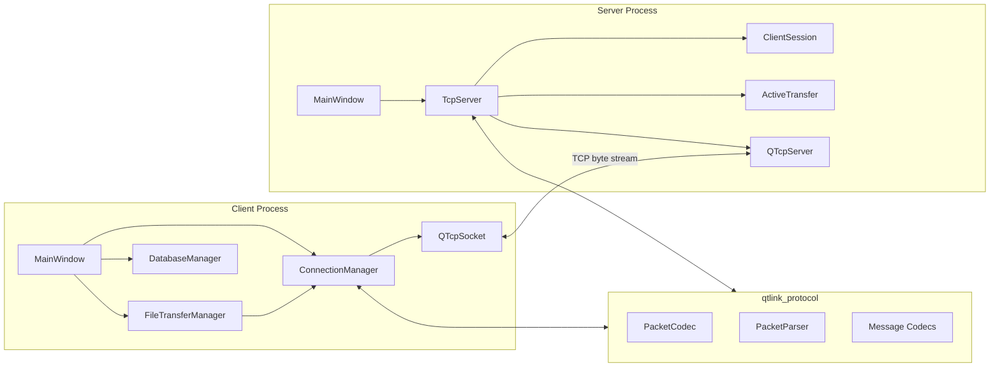
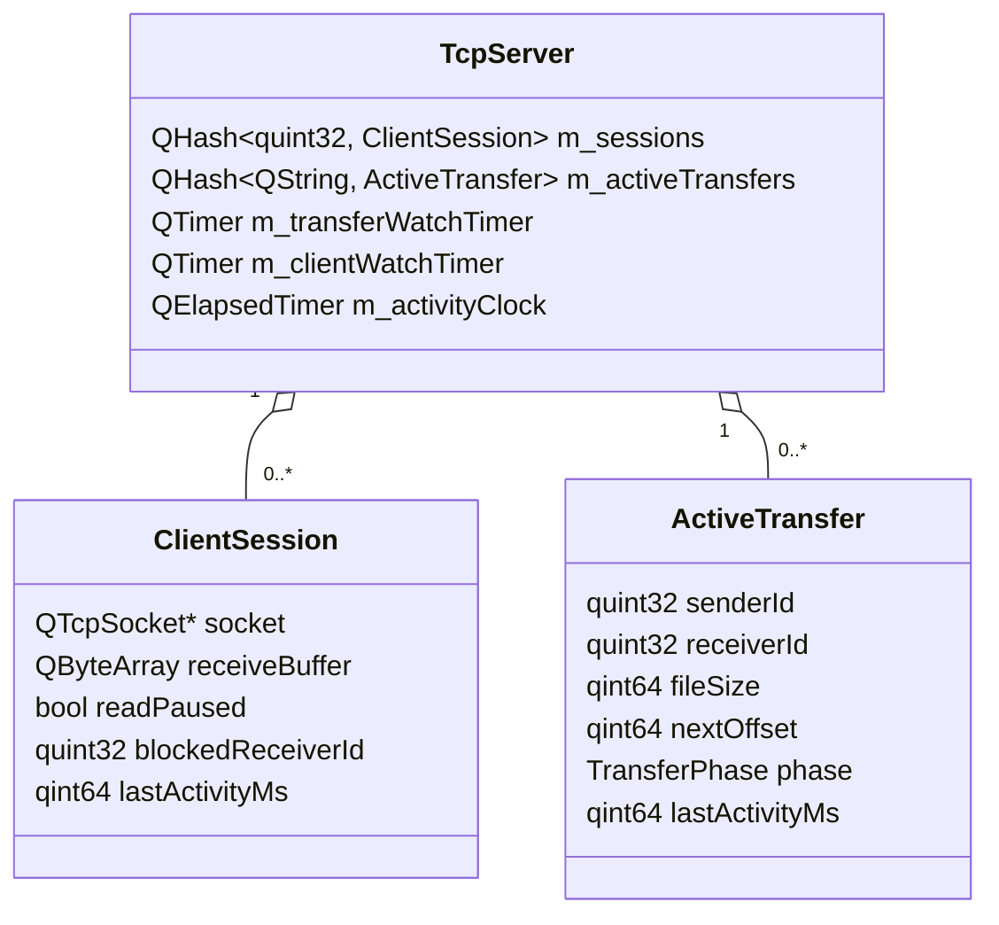
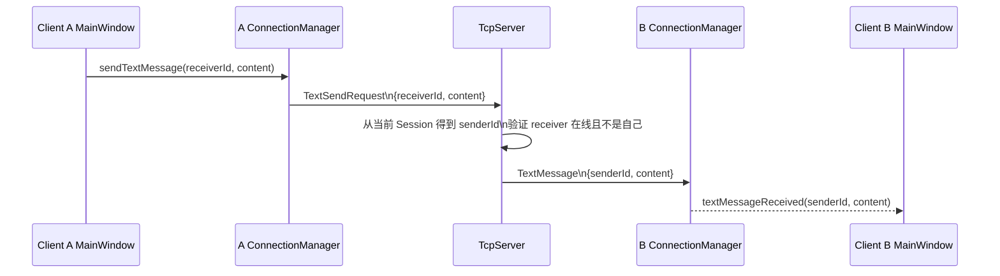
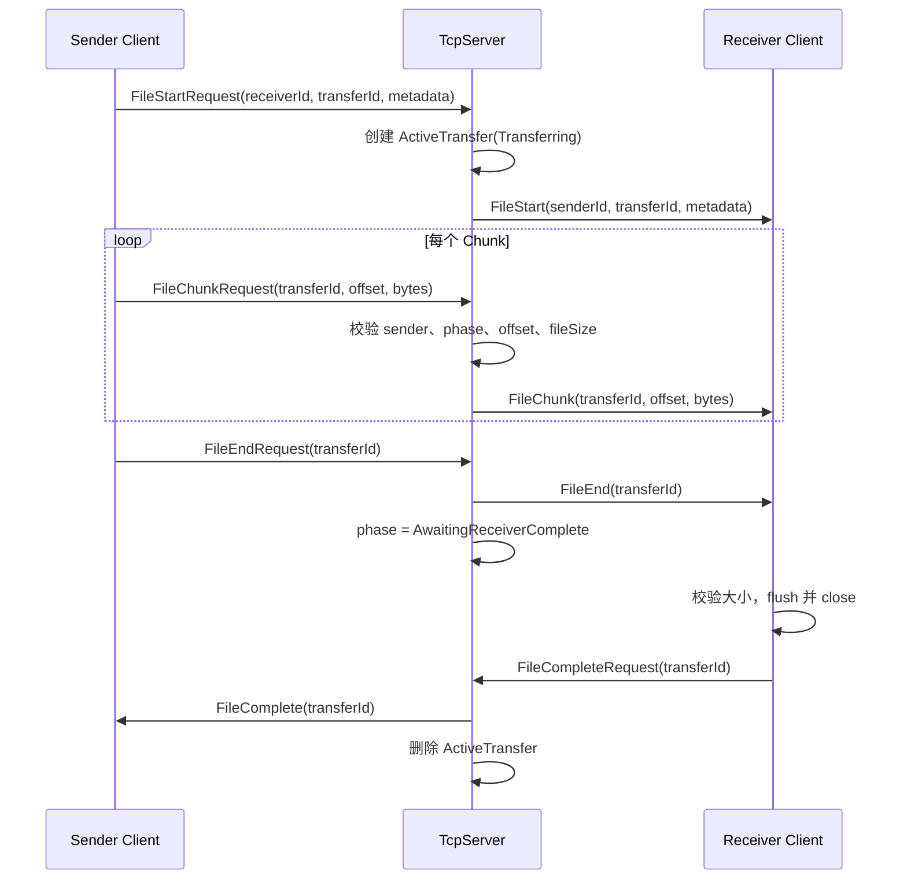
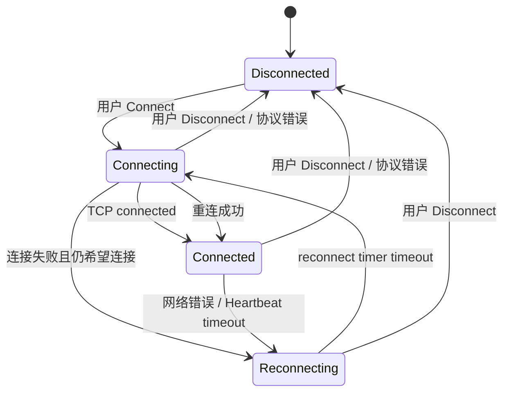
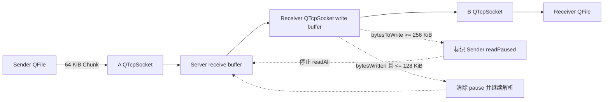

# QtLink 架构说明

## 1. 总体结构

QtLink 采用单进程 Qt Widgets Client、单进程 Qt Widgets Server 的 Client-Server 结构。每个进程运行在 Qt 事件循环中，通过异步 `QTcpSocket` / `QTcpServer` 通信；项目没有额外工作线程或线程池。

`common/protocol` 构建为 `qtlink_protocol` 静态库，由 Client、Server 和测试共同使用。Server 只验证并中继消息，不保存聊天数据库或传输文件。

## 2. Client 架构

### MainWindow

`MainWindow` 负责界面交互和展示：连接参数、在线客户端选择、文本发送、文件选择与发送进度。在线列表中的 `QComboBox` 保存真实 `receiverId`，并排除当前客户端自己的 `selfId`。连接断开时，界面会清空旧在线列表和接收者选择。

文本历史由 `MainWindow` 调用 `DatabaseManager` 保存和恢复。数据库位于 `QStandardPaths::AppDataLocation/qtlink.db`，重连不会清空本地历史。

### ConnectionManager

`ConnectionManager` 负责：

- `QTcpSocket` 的连接、断开和 Packet 收发；
- 每条连接的 persistent receive buffer；
- Text、OnlineClientList、File 控制消息与 Heartbeat 的 Codec 调用；
- `Disconnected / Connecting / Connected / Reconnecting` 状态；
- Heartbeat timeout；
- 保存最近一次连接目标并进行 exponential backoff 自动重连。

网络层错误通过 `connectionError` 报告，已连接后的协议或操作错误通过 `operationError` 报告。协议错误会终止当前连接意图；普通网络故障和心跳超时保留用户连接意图并进入重连。

### FileTransferManager

`FileTransferManager` 管理文件 I/O 和文件传输业务状态，不直接解析 TCP Packet。发送状态为 `Idle / Starting / Sending / Finishing`；发送端进入 `Finishing` 后等待接收端经 Server 返回 `FileComplete`，不会用本地 `bytesToWrite()==0` 代替远端完成确认。

接收端为每个 transfer 保存 `senderId`、声明的 `fileSize`、`nextOffset` 和已打开的 `QFile`。接收文件使用 `QIODevice::NewOnly` 在 Downloads/QtLink 中原子创建，避免覆盖已有同名文件。失败和断线清理残缺文件，完成文件在 flush、close 后保留。

## 3. Server 架构

`TcpServer` 负责监听、多客户端 Session、协议方向检查、文本转发、在线列表广播、文件传输验证与中继，以及连接和传输 watchdog。

`ClientSession` 由临时 `clientId` 索引，每条连接有独立接收缓冲和背压状态。`ActiveTransfer` 由 UUID 字符串索引，阶段为 `Transferring` 或 `AwaitingReceiverComplete`。Server 对 sender/receiver 身份、Chunk offset、文件大小和阶段进行验证。

## 4. common/protocol

协议模块职责分为三层：

- `Packet`：表示已经拆分出的 MessageType 和 Body；
- `PacketCodec`：固定 Header 的 BigEndian 编解码；
- `PacketParser`：从 persistent buffer 中判断完整包、半包或非法包；
- Message Codec：Text、在线列表、文件控制和 FileChunk Body 的字段校验与序列化。

`PacketParser` 成功解析后只移除当前 Packet。Client 和每个 Server Session 都持有自己的 persistent buffer，因此不同连接的数据不会相互混合。

## 5. QObject ownership 与生命周期

| 对象 | 所有者 / 清理方式 |
| --- | --- |
| Client `ConnectionManager` | `MainWindow` 创建并以其为 parent |
| Client `FileTransferManager` | `MainWindow` 创建并以其为 parent |
| Client socket、heartbeat timer、reconnect timer | `ConnectionManager` 的 QObject children |
| 接收中的 `QFile` | 由 `FileTransferManager` 管理；完成或失败时 close 并释放 |
| `DatabaseManager` | `MainWindow` 的值成员；析构时关闭并移除专用 SQL connection |
| Server `TcpServer` | Server `MainWindow` 创建并以其为 parent |
| Server listener、watchdog timers | `TcpServer` 的 QObject children |
| Server client socket | 断开回调先清理 Session/Transfer，再 `deleteLater()` |

Server 停止时先取得 socket 快照再逐个断开，避免 `disconnected` 回调删除 `m_sessions` 时使容器迭代器失效。Client 销毁或主动断开时会停止重连意图和 timer，防止程序退出期间重新连接。

## 6. 文本消息调用链

`senderId` 不由发送客户端提供。Server 使用当前 TCP Session 的 `clientId`，避免客户端伪造发送者身份。发送和接收成功的消息由各自 Client 写入本地 SQLite 历史。

## 7. 文件传输调用链

任一参与方或 Server 可用 `FileAbortRequest/FileAbort` 终止传输。Server 对请求者身份和阶段进行验证，首个通过验证的 Complete、Abort 或 disconnect 终态获胜。控制消息发送失败时通过断开连接触发现有清理路径，避免状态永久停留。

## 8. Heartbeat 与 Reconnect

客户端每 15 秒执行 heartbeat 检查，并发送空 Body 的 `HeartbeatRequest`；90 秒没有收到完整合法 Server Packet 时 abort 当前 socket。网络故障保留 `m_connectionDesired`，因此进入自动重连；协议错误按当前设计停止重连。成功连接会重新初始化活动时间、启动 heartbeat timer，并把退避延迟重置为初始值。

Server 收到任意完整合法 Client Packet 后刷新 Session 活动时间。Client watchdog 跳过 `readPaused` 的 Session，因为此时是 Server 为背压主动停止读取，不能据此判断客户端失活。文件传输另由 transfer watchdog 检查无进展超时。

## 9. Backpressure 数据流

Client 发送端同样依据本地 socket 待写字节数限制 pump，不会无限读取 `QFile`。Server 下游达到高水位后，在读取和解析下一个 Packet 前暂停对应 Sender；低于低水位后才恢复，形成 hysteresis。暂停期间 socket read buffer 也有上限，使 TCP 流控继续向发送 Client 传播。Transfer Abort、Complete、timeout 或 receiver disconnect 会解除已经失效的 pause 依赖。
