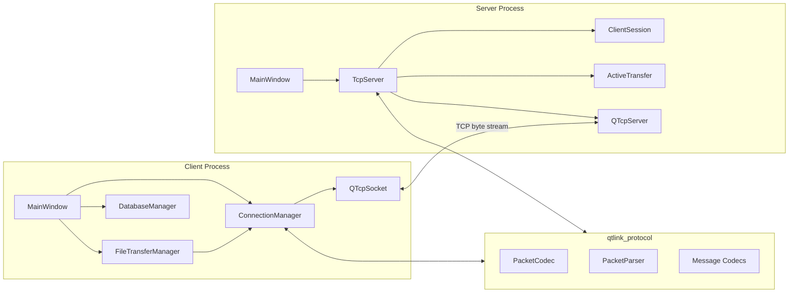
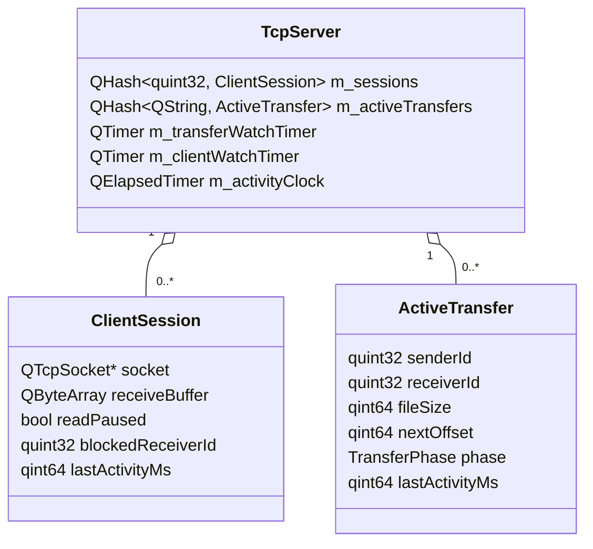
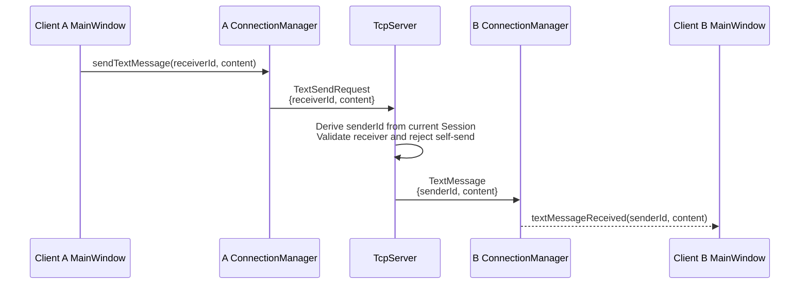
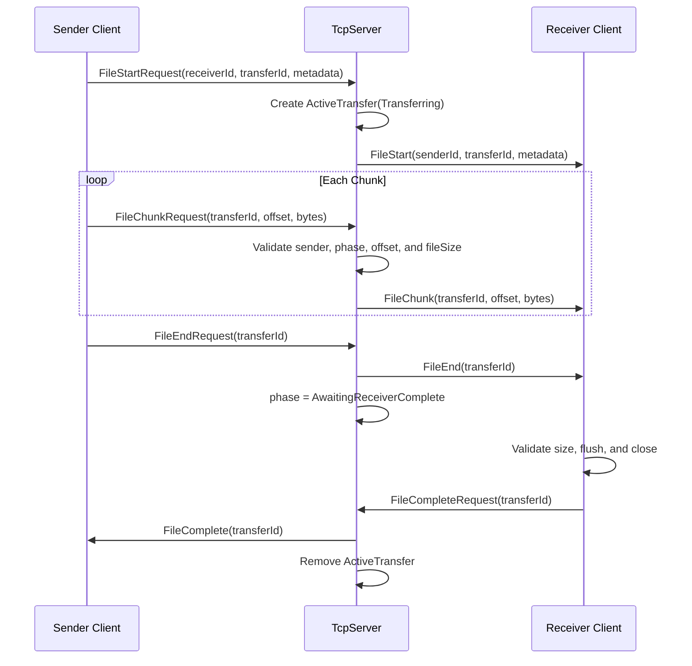
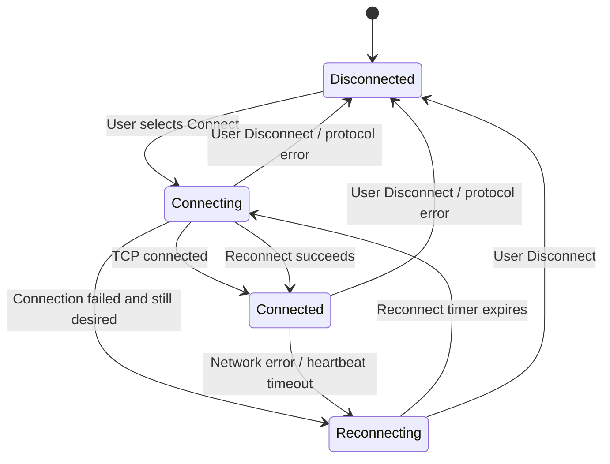
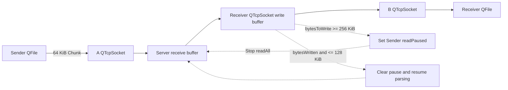

# QtLink Architecture

## 1. System Overview

QtLink uses a Client-Server design with a Qt Widgets Client process and a Qt Widgets Server process. Each process runs on the Qt event loop and communicates asynchronously through `QTcpSocket` / `QTcpServer`. The project does not create additional worker threads or thread pools.

`common/protocol` is built as the `qtlink_protocol` static library and shared by the Client, Server, and test targets. The Server validates and relays messages; it does not store chat history or transferred files.

## 2. Client Architecture

### MainWindow

`MainWindow` handles UI interaction and presentation: connection settings, online client selection, text messaging, file selection, and send progress. The online-client `QComboBox` stores the actual `receiverId` and excludes the Client's own `selfId`. On disconnect, the UI clears the old online list and receiver selection.

For text history, `MainWindow` uses `DatabaseManager` to save and load messages. The database is stored at `QStandardPaths::AppDataLocation/qtlink.db`; reconnecting does not clear local history.

### ConnectionManager

`ConnectionManager` is responsible for:

- `QTcpSocket` connection, disconnection, and Packet I/O;
- the persistent receive buffer for the current connection;
- codec dispatch for Text, OnlineClientList, file control messages, and Heartbeat;
- the `Disconnected / Connecting / Connected / Reconnecting` state model;
- heartbeat timeout handling;
- storing the most recent endpoint and performing exponential-backoff reconnects.

TCP and connection errors are reported through `connectionError`, while protocol and operation failures after connection are reported through `operationError`. Protocol errors terminate the current connection intent. Ordinary network failures and heartbeat timeouts preserve user connection intent and enter the reconnect flow.

### FileTransferManager

`FileTransferManager` owns file I/O and file-transfer business state; it does not parse TCP Packets directly. The outgoing state is `Idle / Starting / Sending / Finishing`. Once the Sender enters `Finishing`, it waits for `FileComplete` from the Receiver through the Server and does not treat local `bytesToWrite()==0` as remote completion.

For each incoming transfer, the manager stores `senderId`, declared `fileSize`, `nextOffset`, and an open `QFile`. Received files are atomically created under Downloads/QtLink with `QIODevice::NewOnly`, preventing an existing file from being overwritten. Failure and disconnect cleanup removes partial files, while a successfully flushed and closed file is retained.

## 3. Server Architecture

`TcpServer` owns the listener, multi-client Sessions, protocol direction checks, text routing, online-list broadcasts, file transfer validation and forwarding, and the connection and transfer watchdogs.

A temporary `clientId` indexes each `ClientSession`, and every connection has an independent receive buffer and backpressure state. A normalized UUID string indexes each `ActiveTransfer`, whose phase is either `Transferring` or `AwaitingReceiverComplete`. The Server validates sender/receiver identity, Chunk offset, declared file size, and transfer phase.

## 4. common/protocol

The protocol module separates four responsibilities:

- `Packet`: a parsed MessageType and Body;
- `PacketCodec`: BigEndian encoding and decoding of the fixed Header;
- `PacketParser`: detection of a complete packet, an incomplete packet, or invalid input in a persistent buffer;
- message codecs: field validation and serialization for Text, online lists, file control messages, and FileChunk.

After a successful parse, `PacketParser` removes only the current Packet. The Client and every Server Session own separate persistent buffers, so data from different connections cannot be mixed.

## 5. QObject Ownership and Lifetime

| Object | Owner / cleanup path |
| --- | --- |
| Client `ConnectionManager` | Created by `MainWindow` with `MainWindow` as parent |
| Client `FileTransferManager` | Created by `MainWindow` with `MainWindow` as parent |
| Client socket, heartbeat timer, reconnect timer | QObject children of `ConnectionManager` |
| Incoming `QFile` | Managed by `FileTransferManager`; closed and released on completion or failure |
| `DatabaseManager` | Value member of `MainWindow`; closes and removes its dedicated SQL connection during destruction |
| Server `TcpServer` | Created by the Server `MainWindow` with it as parent |
| Server listener and watchdog timers | QObject children of `TcpServer` |
| Server client socket | Disconnect callback cleans Session and transfer state before `deleteLater()` |

When the Server stops, it first takes a socket snapshot and then disconnects each socket. This prevents `disconnected` callbacks from invalidating an iterator over `m_sessions`. Client destruction or a manual disconnect clears reconnect intent and stops the timer, preventing a new connection during application shutdown.

## 6. Text Message Flow

The sending Client never supplies `senderId`. The Server uses the current TCP Session's `clientId`, preventing a Client from impersonating another sender. Each Client records successfully sent and received messages in its local SQLite history.

## 7. File Transfer Flow

Either participant or the Server can terminate a transfer with `FileAbortRequest/FileAbort`. The Server validates requester identity and transfer phase. The first validated terminal event among Complete, Abort, or disconnect wins. If a control message cannot be submitted, the implementation disconnects the affected connection so existing cleanup paths can converge the state.

## 8. Heartbeat and Reconnect

Every 15 seconds, the Client performs its heartbeat check and sends an empty-body `HeartbeatRequest`. If no complete valid Server Packet has arrived for 90 seconds, it aborts the current socket. A network failure preserves `m_connectionDesired` and therefore enters automatic reconnect. A protocol error stops reconnect according to the current design. A successful connection resets the activity baseline, starts the heartbeat timer, and restores the reconnect delay to its initial value.

The Server refreshes Session activity after parsing any complete valid Client Packet. Its client watchdog skips a `readPaused` Session because the Server intentionally stopped reading that connection for backpressure and cannot infer client failure from silence. A separate transfer watchdog handles stalled file transfers.

## 9. Backpressure Data Flow

The Client send path also limits its pump according to the local socket's pending bytes and does not read the entire `QFile` eagerly. When the Server's downstream buffer reaches the high-water mark, it pauses the corresponding Sender before reading or parsing the next Packet. It resumes only at or below the low-water mark, forming hysteresis. The socket receive-buffer limit lets TCP flow control propagate back to the sending Client. Transfer Abort, Complete, timeout, or Receiver disconnect removes obsolete pause dependencies.
